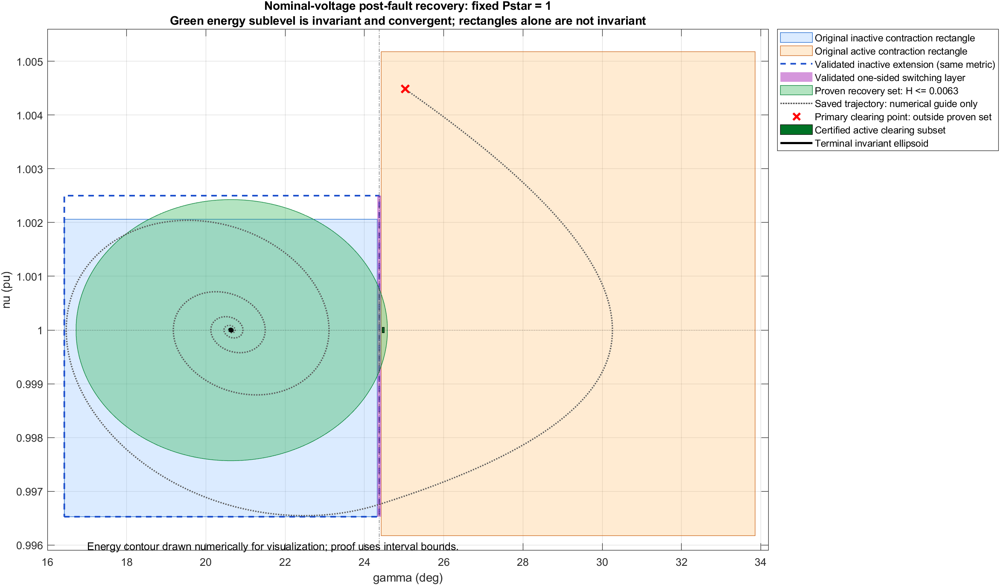

# Radial GFM: switching connection and a certified recovery subset

**Result:** the 0.1-degree gap is closed using the two existing polynomial metrics without altering their coefficients. A nontrivial, fault-independent nominal-voltage recovery set is established by combining their validated domains with a separate energy/Lyapunov invariance argument. This is not a uniform hybrid-contraction or full EMT certificate. The previously saved primary clearing state is outside the proven recovery set.

## A. Switching and one-sided dynamics

The model remains SCR5/XR10, physical Xeq=.350, Vset=1, Qstar=0, radial Imax=1.2, radial umax=1.3, H=3.4, K=20, Kd=5, D=25. Pstar=1 is fixed. Time is physical seconds, omega=100*pi. The same ideal-current-reference proxy and instantaneous Q-V algebraic closure are retained, not actual dynamic PI/filter states.

For each branch, solve E+.1 Qgrid(gamma,E)=1. With q=(E exp(j(gamma+arg(Vth)))-Vth)/Zeq, use Iconv=q when inactive, Iconv=1.2 q/|q| when active. Reconstruct Vc=Vth+Zeq Iconv, measured grid voltage/current and Pe+jQgrid with the saved nodal coefficients. The voltage-command feasibility check remains |Vc+(Zconverter+.2)Iconv|<=1.3.

f=[omega(nu-1); ((1-Pe)/nu-25(nu-1))/6.8],

J=[[0,omega],[-Pe_gamma_total/(6.8 nu), (-(1-Pe)/nu^2-25)/6.8]].

All derivatives include implicit Q-V variation. The switching function is the raw proxy magnitude minus 1.2; it depends on gamma, not nu, in this reduction. Its two branch representations have the same zero and positive one-sided derivatives.

| Switching quantity | Result |
|---|---|
| gamma_switch | 24.3734304197121 deg |
| directed root bracket, radians | [0.42539661082871958, 0.42539661083071958] |
| E at switch, both branches | 1.00122274778007 pu |
| Pe at switch, both branches | 1.17309010862117 pu |
| Pe_gamma inactive / active | 2.61821792763416 / -0.140081398881124 pu/rad |
| ds/dgamma inactive / active | approximately 2.78223478074 / 2.80885512273 |
| saved release time | 0.428985231116 s |
| interpolated nu at release | 0.996757180862 |
| interpolated gamma_dot at release | -1.01876167824 rad/s |
| interpolated ds/dt, inactive-side convention | -2.83443417521 s^-1 |

At |q|=1.2 the two current formulas coincide identically; their network powers and Q-V residuals therefore coincide. Verified local uniqueness of the Q-V roots gives the same E and f on the switching surface. The saved crossing is numerically transversal, from active to inactive, not grazing. These interpolated crossing values are observations, not a validated trajectory enclosure.

At that observed crossing the one-sided Jacobians are approximately

```text
J_inactive = [0, 314.159265359; -0.386284699598, -3.650850265773]
J_active   = [0, 314.159265359;  0.020667225793, -3.650850265773]
```

With identity state reset and a transversal crossing, the saltation matrix is
S=I+(f_plus-f_minus)n'/(n'f_minus)=I,
because continuity has been established. This formula includes first-order crossing-time shifts; identity reset alone would not suffice. At nu=1 the crossing is tangent (n'f=0), and the transversal formula is not applied. The energy argument below also covers tangencies. Reference: [Kong et al., Saltation Matrices](https://arxiv.org/abs/2306.06862).

## B. Closing the layer without a new metric

Full-precision coefficients, centers and scales were loaded from the existing JSON files and verified unchanged. One-sided formal extensions were interval-validated through a 1e-12-rad overlap around the bracketed switch; the physical branches are restricted by the exact switch root. Positive raw-current derivatives and the bracket certify the correct side selection. Negative raw-current *interval margins* in formal-extension logs are over-enclosures and are not claims that a wrong branch is physical.

| Validation | Domain change | Result |
|---|---|---|
| Active metric, lambda=.1 | extend lower gamma to switch | 116 terminal boxes passed; same metric, M<10I |
| Inactive metric, lambda=1 | extend upper gamma to switch | 11 terminal boxes passed; same metric, M<12I |
| Inactive recovery extension, lambda=1 | gamma [16.426345885756, switch], nu [.99652713910517932,1.0025] | 1261 terminal boxes passed; same metric, M<15I |

Each accepted validation proves M>1e-5 I and Qc=J'M+MJ+Mdot+2 lambda M < -1e-5 I, using the full Lie derivative and directed 30-digit interval arithmetic. The original inactive M<10I cap failed in a tiny extension corner; positivity and contraction did not require a new metric. Increasing the *reported metric upper bound* to 12 or 15 changes neither coefficients nor physical parameters. The original certificates remain unchanged.

The small nu extension is needed to enclose the invariant energy set below; it is separately validated. No bridge metric was optimized. The former angular gap is covered by the appropriate one-sided metrics, not by a newly asserted common smooth metric.

## C. Metric-transition gains and their limits

At the switch, directed interval quadratic-form tests establish:

| Event strip | Active -> inactive squared-length gain | Inactive -> active squared-length gain |
|---|---:|---:|
| Full compatible nu range [.99652713910517932,1.0025] | <=256 | <=2 |
| Proven recovery-set event strip [.9992,1.0008] | <=4 | <=2 |

For example, M_inactive <= 4 M_active on the smaller strip, so differential length can increase by at most 2 at an active-to-inactive transversal transition. These are conservative verified gains, not tight extrema. For transversal trajectories staying in the certified domains with a common event sequence,

length(t) <= product(sqrt(kappa_j)) exp(-sum(lambda_i*T_i)) length(0).

Repeated crossings require each gain to be included. No dwell-time bound or gain-free common hybrid metric is established. Hence piecewise contraction and finite transition gains alone do not prove uniform hybrid exponential contraction. The smaller strip follows from the energy inequality below, not from interpolation of a trajectory.

## D. A rigorous post-fault recovery set

Define the continuous piecewise electrical characteristic at nominal grid voltage and

W(gamma)=integral from gamma_eq to gamma of (Pe(a)-1) da,

T(nu)=6.8*omega*((nu-1)^2/2+(nu-1)^3/3),

Hrec(gamma,nu)=W(gamma)+T(nu).

This Hrec is an energy function, not the inertia H=3.4. Direct differentiation gives, on both branches and at their continuous join,

**Hrec_dot = -25*omega*nu*(nu-1)^2 <= 0** for nu>0.

Let B=[0.28669381977787517,0.5909407406288647] rad x [.9975,1.0025]. Define precisely

**Omega = {x in B : Hrec(x)<=0.0063}.**

Directed interval Riemann sums, implicit-root enclosures, and explicit root-bracket correction bounds give:

| Boundary / quantity | Verified bound |
|---|---|
| W at lower gamma wall | [0.0072822023,0.0073037215] |
| W at upper gamma wall | [0.0318899205,0.0324579728] |
| T at nu=.9975 | >0.0066647579 |
| T at nu=1.0025 | >0.0066870108 |
| W at switching | [0.0056626116,0.0056810129] |

The unrounded endpoints used for proof are in connection_validation.json. Pe_gamma>0 is verified throughout the inactive part (lower bound >2.617), and Pe>1 throughout the active part. The bracketed nominal equilibrium is thus the unique root Pe=1 in B; W>=0. All walls have energy strictly above .0063, so Omega is compact and cannot exit B. Hrec cannot increase, hence Omega is forward-invariant. Throughout B the correct physical current branch obeys Imax, and the voltage-command margin is >.04946 pu (inactive margin >.05091 pu).

On Hrec_dot=0, nu=1. The only invariant state there has Pe=1, hence is the nominal equilibrium. LaSalle's invariance argument proves convergence of every state in Omega to that equilibrium. Since the previously certified invariant ellipsoid is a neighbourhood of the equilibrium, each such trajectory enters its interior after some finite time and then remains there. No uniform entrance-time bound is claimed. This establishes invariance and terminal convergence by an energy argument in addition to the contraction tests; it is not inferred from rectangle contraction alone.

Omega lies in the union of the extended certified one-sided contraction domains and the switching surface. A concrete nontrivial limiter-active clearing subset contained in Omega is

```text
gamma in [0.4267322646126135, 0.4276056667386107] rad
nu    in [0.99995, 1.00005]
```

These are approximately gamma=24.449958 to 24.500000 deg. Its verified maximum energy is <0.006065764335<0.0063. It is inside the original active rectangle, respects all physical limits, crosses eventually into the inactive side, and converges to the nominal equilibrium. Early re-entry has not been excluded; all crossings and possible tangencies are covered by Hrec monotonicity. Once Hrec<W(gamma_switch), further re-entry is impossible. Convergence guarantees this eventually, but a single-crossing sequence is not asserted for every point.

At a switch inside Omega, T(nu)<=.0063-W_switch implies .9992<nu<1.0008, validating the smaller metric-gain strip above.

## E. The primary clearing state is not yet certified

The saved primary state (25.027638262623 deg, 1.004481785586) has numerical Hrec=0.0291581842383, outside Omega. Its saved trajectory stays in the displayed rectangles and recovers numerically, but those observations are not a rigorous enclosure. Its energy exceeds the lower-wall barrier .00728, so this conservative invariant-set argument cannot ensure its first excursion stays in the certified recovery corridor.

Precisely what remains for THAT state: a validated flow tube, a sharper dissipative funnel or a larger invariant construction proving its path through the active region and switching layer and into Omega/the terminal ellipsoid. No continuous-time containment or recovery guarantee is claimed for that primary state or all of R2. A nontrivial subset, rather than the whole R2, has been certified as permitted by the task.

## F. Diagram, scope and files

The state-space diagram distinguishes the original rectangles, validated extensions/layer, terminal ellipsoid, Omega, the active clearing subset, and the unproven primary state. The saved trajectory and drawn energy contour are numerical visualization only; the recovery proof uses the interval inequalities above.



New results are confined to radial_switch_connection_20261001. No new faults, ODE trajectories, EMT runs, controller changes or metric optimization were performed. All previous coefficients, network conventions and certified files are preserved. Certificates concern the fixed published decimal reduced-network model with quasi-static Q-V closure, not uncertain network parameters or full dynamic EMT controllers.

Reproduce with analyze_radial_switch_connection.m, prepare_radial_switch_validation.py, the two one-sided checkers, extend_inactive_recovery_box.py, validate_switch_recovery_connection.py and validate_recovery_transition_gain.py. Original metrics are read at full precision. The additional M upper bounds are validation bounds only. Existing invariant_subset.json defines the unchanged terminal ellipsoid (rho=5.415991846817519e-10).
